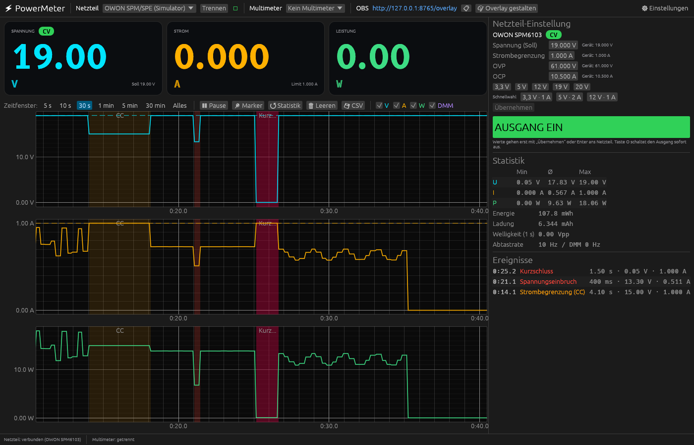
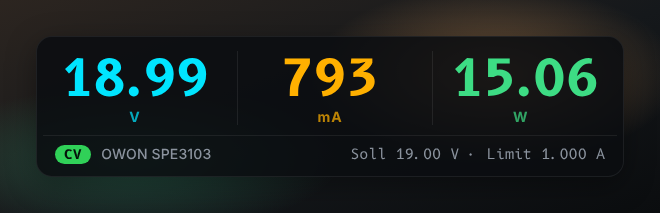
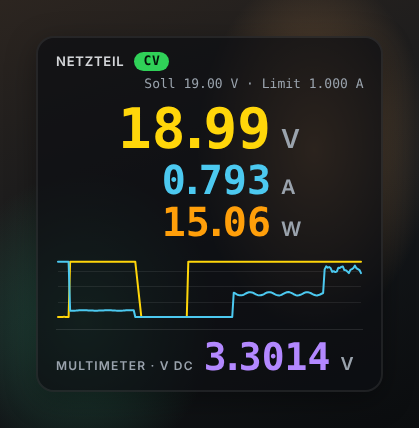
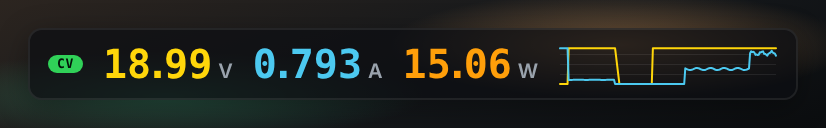

# ⚡ PowerMeter

Live-Messwerte von **Labornetzteil** und **Multimeter** auf Windows und Mac, mit Graphen, CV/CC-Erkennung, Spannungseinbrüchen und einem **OBS-Overlay**, das du im **Overlay-Studio** selbst gestaltest. Gemacht für Reparaturvideos.



## Was es kann

- **Netzteil-Werte live**: Spannung, Strom und Leistung mit 100 Messungen pro Sekunde, über das Messmodul zwischen Netzteil und Gerät ([Hardware & Einkaufsliste](docs/HARDWARE.md)).
- **OWON SPM und SPE** (SPM3051/6053/3103/6103, SPE3102/3103/6103 …, baugleiche multicomp-pro- und Kiprim-DC-Geräte wie DC310S/DC605S) direkt über USB: Spannung, Strom und Leistung, die eingestellten Sollwerte, CV/CC und Schutzabschaltungen (OVP/OCP/OTP) kommen vom Netzteil selbst, angezeigt mit der Auflösung, die das Netzteil wirklich hat (10 mV / 1 mA). Sollspannung, Strombegrenzung, OVP/OCP und den Ausgang stellst du aus der App, **Schnellwahl-Knöpfe** (z. B. „5 V · 2 A“) stellen Spannung und Strom mit einem Klick ein, Taste `O` schaltet den Ausgang sofort aus. **Verbindung prüfen** testet den Anschluss, ohne etwas zu verstellen. Das eingebaute Multimeter des SPM lässt sich als Multimeter der App nutzen (das SPE hat keins). Mit der PowerMon-Box zusammen liefert die Box die schnellen Messwerte (100 Hz) und das Netzteil den Rest ([Details](docs/HARDWARE.md#owon-spm-und-spe)).
- **OWON XDM1241** (auch XDM1041/2041) über USB/SCPI. Messfunktion und Messrate lassen sich aus der App umschalten, und Drehen am Gerät erkennt die App selbst.
- **Graphen** für U, I, P und das Multimeter mit gemeinsamer Zeitachse. Zeitfenster von 5 s bis „Alles“. Spitzen und Einbrüche gehen auch bei langen Zeitfenstern nicht verloren (Min/Max-Ausdünnung).
- **CV / CC** als Anzeige. Beim OWON SPM kommen Sollwerte und CV/CC vom Netzteil. Sonst lernt die App die Soll-Spannung und die Strombegrenzung automatisch (im Overlay mit „≈“ markiert) oder du trägst sie ein.
- **Ereignisse**: Spannungseinbrüche, Strombegrenzung und Kurzschlüsse werden im Graphen farbig hinterlegt und aufgelistet. Ein Klick auf ein Ereignis springt im Graphen dorthin.
- **Energie & Ladung** (Wh, mAh), Min/Ø/Max, Welligkeit (Vpp) und Spitzenstrom.
- **Marker** (Taste `M`) markieren Momente für den Videoschnitt.
- **OBS-Overlay** als Browser-Quelle mit transparentem Hintergrund, gestaltet im **Overlay-Studio** im Browser: acht Vorlagen (Messgerät, Verlauf, Klassisch, Leiste, Minimal, Seitenleiste, Labornetzteil, Neon), eigene Farben, Schriften, Logo und Elemente, Live-Vorschau mit Beispielwerten. Änderungen erscheinen in OBS sofort ([Anleitung](docs/OVERLAY.md)).
- **Kalibrierung** des Messmoduls gegen das Multimeter per Knopfdruck.
- **CSV-Export** (Taste `E`) nach `Dokumente/PowerMeter` (Windows: `%USERPROFILE%\Documents\PowerMeter`, Mac: `~/Documents/PowerMeter`).
- **Simulator** für Netzteil und Multimeter: Alles lässt sich ohne Hardware ausprobieren. „OWON SPM/SPE (Simulator)“ spielt ein SPM6103 nach, über denselben Treiber wie das echte Gerät.

## OBS einrichten

1. App starten und oben auf **🎨 Overlay gestalten** klicken. Das Overlay-Studio öffnet sich im Browser.
2. Eine Vorlage aussuchen und nach Geschmack anpassen. Gespeichert wird automatisch.
3. Unter „In OBS einfügen“ **URL kopieren**. In OBS: **Quellen → + → Browser**, URL einfügen, Breite und Höhe wie im Studio angegeben eintragen, „Benutzerdefiniertes CSS“ leeren.



| Klassisch | Leiste |
|---|---|
|  |  |

`http://127.0.0.1:8765/overlay` (📋 oben in der App) zeigt immer dein Standard-Design; ältere URLs mit Parametern funktionieren weiter. Mehrere Designs gleichzeitig, eigenes CSS, die Rohdaten unter `/api/live` und die alten URL-Parameter stehen in [docs/OVERLAY.md](docs/OVERLAY.md).

## Latenz & Genauigkeit

- Das Messmodul (INA228, 20 Bit) mittelt intern 16 Messungen und schickt alle 10 ms einen Wert. Die App zeichnet ihn sofort im nächsten Frame.
- Die **großen Zahlen** mitteln standardmäßig über 100 ms, damit die letzte Stelle im Video lesbar bleibt. Unter ⚙ lässt sich das auf 0 (roh) stellen. **Graphen und Ereignisse arbeiten immer mit den Rohdaten.**
- Das Multimeter wird so schnell abgefragt, wie es antwortet (Messrate „Schnell“). Die App zeigt 5 signifikante Stellen (passend zu den 55 000 Counts des XDM1241), unter ⚙ einstellbar.

## Bauen

Voraussetzung: [Rust](https://rustup.rs).

```sh
cargo run --release              # starten
./scripts/bundle_macos.sh        # dist/PowerMeter.app (Apple Silicon + Intel)
```

Beim ersten Start einer selbst gebauten App: Rechtsklick → **Öffnen**. Jeder Push baut die App auch auf GitHub Actions (Artefakt „PowerMeter-macOS“).

Unter **Windows** genügt `cargo build --release`; die fertige `target\release\powermeter.exe` läuft ohne Installation. Hinweise zu Treiber, COM-Port und SmartScreen stehen unten.

Ein OWON SPM/SPE einmal testen, ohne Fenster und ohne etwas am Netzteil zu verstellen (es wird nur gelesen). In der App geht dasselbe mit **Verbindung prüfen** unter ⚙ Einstellungen → OWON SPM/SPE.

```sh
cargo run --release -- --probe-spm auto                          # erster USB-Seriell-Adapter
cargo run --release -- --probe-spm COM3                          # Windows, Port anpassen; optional Baudrate dahinter
cargo run --release -- --probe-spm /dev/cu.usbserial-1410        # Mac
cargo run --release -- --probe-spm sim                           # gegen den Simulator
```

Die Ausgabe zeigt die Antwort auf `*IDN?`, 50 Messungen mit Zeitstempel (daraus: wie oft das Netzteil wirklich neue Werte liefert), die Sollwerte, den Ausgang und das Multimeter. In der Windows-PowerShell bei der fertigen `.exe` am besten `| Out-Host` anhängen, damit die Eingabeaufforderung erst nach der Ausgabe wiederkommt: `.\powermeter.exe --probe-spm auto | Out-Host`.

## Windows

- **Treiber**: Das OWON SPM/SPE hat einen CH340-USB-Chip. Windows 10/11 installiert den Treiber meist von selbst. Taucht kein Port auf, den „CH341SER“-Treiber von WCH (wch.cn) oder den Treiber von der OWON-Seite installieren.
- **COM-Port finden**: Geräte-Manager → **Anschlüsse (COM & LPT)** → „USB-SERIAL CH340 (COM5)“. Die App zeigt die Ports genauso an („COM5 – USB-SERIAL CH340“).
- **Ein Programm pro Port**: Solange die OWON-PC-Software (oder ein anderes Terminal) den Port offen hat, kommt die App nicht dran. Erst das andere Programm schließen.
- **SmartScreen**: Beim ersten Start einer selbst gebauten oder heruntergeladenen `.exe` warnt Windows. **Weitere Informationen → Trotzdem ausführen**.
- Einstellungen und Designs liegen unter `%APPDATA%\PowerMeter`, CSV-Exporte unter `Dokumente\PowerMeter`.

## Tastenkürzel

| Taste | Aktion |
|---|---|
| Leertaste | Graph anhalten / weiter (angehalten: ziehen und zoomen) |
| `M` | Marker setzen |
| `R` | Statistik & Energie zurücksetzen |
| `E` | CSV-Export |
| `O` | Ausgang **aus** (nur OWON SPM/SPE). Zum Einschalten gibt es absichtlich keine Taste. |

## Aufbau

```
src/
  main.rs            Fenster, --probe-spm
  app.rs             Oberfläche (egui)
  model.rs           Messdaten, Analyse (CV/CC, Einbrüche, Energie)
  overlay.rs         Webserver für OBS und Overlay-Studio (axum, SSE, JSON-API)
  designs.rs         Overlay-Designs, Vorlagen, designs.json
  export.rs          CSV
  devices/
    mod.rs           Gerätearten, SCPI-Verbindung (Pausen, Wiederholung)
    owon.rs          OWON XDM (SCPI über USB-Seriell)
    owon_spm.rs      OWON SPM/SPE (und Kiprim): Netzteil + eingebautes Multimeter, Probe-Modus
    powermon.rs      Messmodul (INA228) über USB
    sim.rs           Simulatoren (auch ein SPM auf SCPI-Ebene)
assets/              overlay.js (Renderer), Overlay, Studio, Startseite, Schrift B612 Mono (OFL)
firmware/powermon/   Arduino-Firmware fürs Messmodul
docs/HARDWARE.md     Einkaufsliste & Verdrahtung, OWON SPM/SPE
docs/OVERLAY.md      Overlay-Studio, OBS, eigenes CSS, Rohdaten
```

Inspiriert von [rusty_meter](https://github.com/markusdd/rusty_meter). Die Schrift B612 Mono steht unter der SIL Open Font License (`assets/fonts/OFL.txt`).
