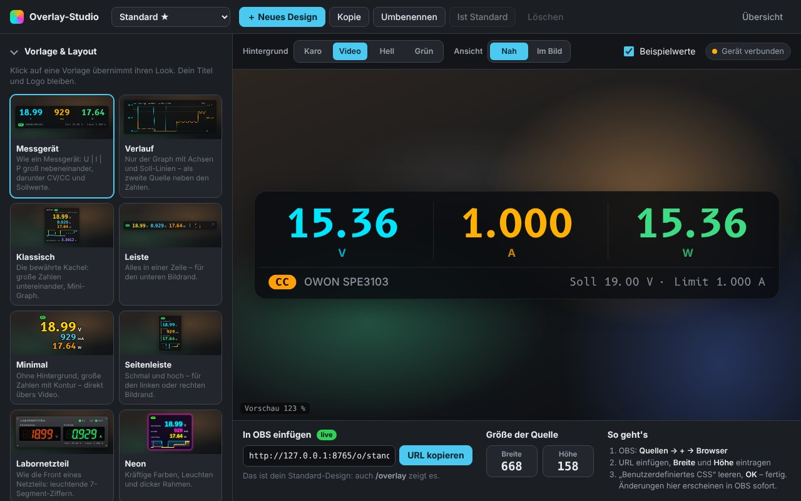
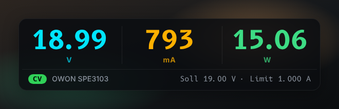

# OBS-Overlay & Overlay-Studio

Die App zeigt ihre Messwerte als **Overlay für OBS**: eine kleine Webseite mit durchsichtigem Hintergrund, die OBS als Browser-Quelle über dein Video legt. Wie das Overlay aussieht, stellst du im **Overlay-Studio** ein, ganz ohne Code.



## Overlay-Studio öffnen

- In der App oben auf **🎨 Overlay gestalten** klicken, oder
- im Browser `http://127.0.0.1:8765/studio` öffnen (die App muss laufen).

Unter `http://127.0.0.1:8765/` gibt es eine Übersicht aller deiner Designs mit Live-Vorschau, URL und der passenden Größe für OBS.

## Vorlagen

Ein **Design** ist ein fertig eingestelltes Overlay. Jedes neue Design startet von einer Vorlage, danach lässt sich alles ändern. Ein Klick auf eine Vorlage im Studio übernimmt ihren Look; dein Titel und dein Logo bleiben, und „Rückgängig“ holt den alten Stand zurück.

| Vorlage | Aussehen | Gut für |
|---|---|---|
| **Messgerät** (Standard) | U, I und P groß nebeneinander in B612 Mono, darunter CV/CC, Gerätename und Sollwerte | fast alles |
| **Verlauf** | nur der Graph: Spannung links, Strom rechts, Soll und Limit gestrichelt | als zweite Quelle neben den Zahlen |
| **Klassisch** | die bewährte Kachel: Zahlen untereinander, Mini-Graph | wie die früheren Versionen |
| **Leiste** | alles in einer Zeile | unterer Bildrand |
| **Minimal** | kein Hintergrund, große Zahlen mit Kontur | direkt übers Video |
| **Seitenleiste** | schmal und hoch | linker oder rechter Bildrand |
| **Labornetzteil** | Front eines Netzteils mit leuchtenden 7-Segment-Ziffern | Retro-Look |
| **Neon** | kräftige Farben, Leuchten, dicker Rahmen | Shorts, Thumbnails |



## In OBS einfügen

1. Im Studio (oder auf der Übersicht) bei deinem Design **URL kopieren**. Sie sieht so aus: `http://127.0.0.1:8765/o/mein-overlay`.
2. In OBS: **Quellen → + → Browser**, die URL einfügen.
3. **Breite** und **Höhe** eintragen, wie im Studio unter „Größe der Quelle“ angegeben. Die Werte haben schon Platz für Warnungen eingerechnet.
4. Das Feld „Benutzerdefiniertes CSS“ leeren, **OK**.

Die Quelle danach einfach mit der Maus an die gewünschte Stelle ziehen. Zum Vergrößern lieber im Studio unter **Zahlen → Größe** drehen als die Quelle in OBS aufzuziehen, dann bleibt alles scharf. Wie groß das Overlay im fertigen Video wirkt, zeigt das Studio mit **Ansicht → Im Bild** (ein 1080p-Bild in echter Proportion).

`http://127.0.0.1:8765/overlay` zeigt immer dein **Standard-Design** (★ im Studio, wählbar mit „Als Standard“). Eine alte URL, die schon in OBS steckt, zeigt also automatisch dein Standard-Design.

### Live-Änderungen

Was du im Studio änderst, wird nach einem Moment automatisch gespeichert („Gespeichert ✓“ oben rechts) und erscheint in OBS sofort, ohne die Quelle neu zu laden. Du kannst also mit OBS daneben gestalten.

## Gestalten

Die Einstellungen im Studio, von oben nach unten:

- **Vorlage & Layout**: Vorlage übernehmen; Layout wechseln (Messgerät, Kachel, Leiste, Ohne Hintergrund, Seitenleiste, Labornetzteil), ohne die Farben zu ändern.
- **Elemente**: an/aus und Reihenfolge (↑ ↓). Spannung, Strom, Leistung, Betriebsart (CV · CC · AUS · Schutz), Gerätename, Soll/Limit, Warnungen, Graph, Titel, Logo, Energie (Wh · mAh · Spitzenstrom), letztes Ereignis, Multimeter. Leere Elemente blenden sich selbst aus: Warnungen nur bei einer Warnung, das Multimeter nur, wenn eins verbunden ist. Faustregel: etwa vier Elemente lesen sich im Video am besten.
- **Text**: Titel (z. B. „MÜCO REPAIR · NETZTEIL“), Beschriftung SPANNUNG/STROM/LEISTUNG, Einheiten, Schrift.
- **Zahlen**: welcher Wert am größten ist, Schrift für Zahlen, Strichstärke, Nachkommastellen, **Kleine Werte in mA / mW** und die Größe.
  - Nachkommastellen „Automatisch“ zeigt so viele Stellen, wie das Gerät wirklich misst: beim OWON SPM/SPE 2 / 3 / 2 (10 mV, 1 mA), bei der PowerMon-Box 3 / 4 / 3. So stehen keine erfundenen Stellen im Bild.
  - Mit mA / mW wird aus `0.118 A` → `118 mA`, mit derselben echten Auflösung.
- **Farben**: je eine Farbe für Spannung, Strom, Leistung, Multimeter, CV, CC, Warnungen, Text und Nebentext; Hintergrund mit Deckkraft, Rahmen, Ecken, Schatten, Leuchten. **Farben aus Vorlage** holt die Farben der Vorlage zurück.
- **Graph**: Kurven, Zeitraum (20 s oder 60 s mit einem Klick, sonst 5–60 s), Breite, Höhe, Linienstärke, Achsen mit Werten (Spannung links, Strom rechts), Soll- und Limit-Linien, Legende, gefüllte Fläche.
- **Logo**: Bild per Klick oder Drag & Drop hochladen (PNG, JPG, GIF, WEBP oder SVG, höchstens 5 MB), Höhe einstellen. Ein PNG mit transparentem Hintergrund sieht am besten aus.
- **Verhalten**: bei Warnungen blinken; ausblenden, wenn kein Gerät verbunden ist (sonst wird das Overlay nur blasser).
- **Profi: eigenes CSS**, siehe unten.

Schriften: Mitgeliefert ist **B612 Mono** (SIL Open Font License, funktioniert überall, auch offline). Die anderen Schriften sind nach ihrem Aussehen benannt und nutzen, was das System hat: Windows nimmt z. B. Segoe UI, Bahnschrift, Consolas oder Cascadia Mono, der Mac SF, DIN oder Menlo. „7-Segment“ zeichnet die Ziffern selbst und sieht deshalb überall gleich aus.

Hintergründe der Vorschau: **Karo** zeigt, was durchsichtig ist, **Video** und **Hell** zeigen den Kontrast über dunklem und hellem Bild, **Grün** ist ein Greenscreen. **Beispielwerte** spielt einen Ablauf mit Laststufen, CC, Einbruch, Kurzschluss, Ausgang aus und Multimeter ab; ohne verbundenes Gerät ist das automatisch an.

## Mehrere Designs

Jedes Design hat seine eigene URL, du kannst also mehrere gleichzeitig in OBS nutzen. Ideen:

- **Messgerät** oben links für die Zahlen und **Verlauf** als zweite Browser-Quelle daneben für den Graphen. Mit „Kopie“ im Studio lassen sich beide farblich angleichen.
- Eine **Leiste** am unteren Rand für die ganze Szene und eine große **Kachel** in einer zweiten OBS-Szene für Nahaufnahmen.
- Ein eigenes Design nur fürs **Multimeter** (Elemente: nur „Multimeter“).

Umbenennen ändert die URL nicht. Wird ein Design gelöscht, dessen URL noch in OBS steckt, zeigt die Quelle einen Hinweis statt Werten. Das Standard-Design lässt sich nicht löschen; erst ein anderes zum Standard machen.

## Eigenes CSS

Für Feinarbeit, die das Studio nicht anbietet. Das CSS gilt nur für dieses eine Overlay (es steckt in einem eigenen Shadow DOM). Deshalb wirken `html` und `body` nicht. Nimm die Klassen des Overlays oder `:host`.

| Klasse | Was |
|---|---|
| `.panel` | die Fläche mit Hintergrund und Rahmen |
| `.num`, `.unit`, `.lbl` | Zahl, Einheit, Beschriftung |
| `.k-v`, `.k-i`, `.k-p` | Zeile/Spalte von Spannung, Strom, Leistung (z. B. `.k-v .num`) |
| `.title`, `.logo`, `.model`, `.set` | Titel, Logo, Gerätename, Soll/Limit |
| `.pill` (`.CV`, `.CC`, `.off`, `.prot`) | Betriebsart-Abzeichen |
| `.flag`, `.banner` | Warnungen |
| `.graph`, `.dmm`, `.energy`, `.events` | Graph, Multimeter, Energie, letztes Ereignis |
| `.ov.alarm`, `.ov.out-off`, `.ov.stale` | gesetzt bei Warnung, Ausgang aus, keine Daten |

Beispiele:

```css
/* Spannung extra groß */
.k-v .num { font-size: 80px; }

/* eckige Fläche mit Akzentlinie links */
.panel { border-radius: 0; border-left: 6px solid #00e5ff; }

/* bei Ausgang aus das ganze Overlay stark abdunkeln */
.ov.out-off .panel { opacity: .35; }
```

## Für Bastler: die Rohdaten

Wer etwas ganz Eigenes bauen will (eigene Seite, Stream Deck, Skript):

- `GET /api/live` liefert den aktuellen Stand als JSON (mit `Access-Control-Allow-Origin: *`).
- `GET /events` ist derselbe Stand als Server-Sent-Events, bis zu 60-mal pro Sekunde. `?spark=60` hängt die letzten 60 s für einen Graphen an (`spark=0`: ohne, Standard 20 s).
- `GET /api/designs`, `GET /api/designs/<id>`, `GET /api/templates`, `GET /api/fonts` lesen Designs, Vorlagen und Schriften. Ändern geht nur über das Studio (siehe Sicherheit).
- `/overlay.js` ist der Renderer, den Overlay, Studio und Übersicht teilen: `PowerOverlay.mount(element, design)` gibt ein Objekt mit `update(snapshot)` zurück.

Die Felder von `/api/live`:

| Feld | Bedeutung |
|---|---|
| `power_connected` | Netzteil-Quelle verbunden |
| `v`, `i`, `p` | Spannung (V), Strom (A), Leistung (W), roh; `null` ohne frische Werte |
| `v_text`, `i_text`, `p_text` | fertig formatiert mit der echten Auflösung |
| `v_decimals`, `i_decimals`, `p_decimals` | Nachkommastellen, die die Quelle wirklich auflöst (SPM/SPE: 2 / 3 / 2) |
| `mode` | `CV`, `CC`, `OFF` oder `--` |
| `v_set`, `i_set`, `v_set_text`, `i_set_text` | Sollspannung und Strombegrenzung |
| `set_from_device`, `set_learned`, `i_set_learned` | Sollwerte vom Netzteil gelesen bzw. nur gelernt („≈“) |
| `psu_connected`, `psu_model` | steuerbares Netzteil (OWON SPM/SPE) verbunden, Modellname |
| `output_on` | Ausgang laut Netzteil an/aus (`null`: unbekannt) |
| `protection` | `"OVP"`, `"OCP"`, `"OTP"` … solange eine Schutzabschaltung aktiv ist |
| `dropout`, `short` | gerade ein Spannungseinbruch / Kurzschluss |
| `dropouts`, `last_event` | Anzahl der Einbrüche, Text zum letzten Ereignis |
| `energy_text`, `charge_text`, `peak_i_text` | Energie, Ladung, Spitzenstrom |
| `dmm_connected`, `dmm_value`, `dmm_text`, `dmm_value_text`, `dmm_unit`, `dmm_function`, `dmm_tag` | Multimeter |
| `design_rev` | zählt bei jeder Design-Änderung hoch |
| `spark` | nur bei `/events`: Zeilen `[t, v, i, p]`, `t` in Sekunden relativ zu jetzt |

## Alte URL-Parameter

Frühere Versionen wurden über URL-Parameter eingestellt. Diese URLs funktionieren weiter und zeigen die Vorlage „Klassisch“ mit den gewünschten Änderungen:

| Parameter | Werte | Standard |
|---|---|---|
| `show` | `v,i,p,mode,set,graph,dmm,energy,events` | `v,i,p,mode,set,graph,dmm` |
| `layout` | `card`, `bar` | `card` |
| `graph` | Kurven im Mini-Graph: `v,i,p` | `v,i` |
| `accent` | größter Wert: `v`, `i`, `p` | `v` |
| `scale` | Größe, z. B. `1.5` | `1` |
| `bg` | Hintergrund-Deckkraft `0`–`1` | `0.72` |

Beispiele:

- Leiste unten: `http://127.0.0.1:8765/overlay?layout=bar&show=v,i,p,mode,graph,dmm`
- Alles inkl. Energie und Ereignisse: `http://127.0.0.1:8765/overlay?show=v,i,p,mode,set,graph,dmm,energy,events&graph=v,i,p`
- Nur das Multimeter, groß: `http://127.0.0.1:8765/overlay?show=dmm&scale=1.4`

Für Neues ist ein eigenes Design im Studio bequemer.

## Wo die Designs liegen

In der Datei `designs.json`, hochgeladene Logos im Ordner `overlay-assets` daneben:

| System | Ordner |
|---|---|
| Windows | `%APPDATA%\PowerMeter` |
| macOS | `~/Library/Application Support/PowerMeter` |
| Linux | `~/.local/share/powermeter` |

Zum Sichern oder Mitnehmen auf einen anderen Rechner einfach den Ordner kopieren. Ist die Datei einmal kaputt, legt die App sie als `designs.json.bak` beiseite und startet mit dem Standard-Design; nichts geht verloren.

## Sicherheit

Ansehen dürfen alle, die den Server erreichen (nur dieser Rechner, außer „Overlay im Netzwerk freigeben“ ist an). **Ändern** geht nur vom selben Rechner und nur über das Studio. Andere Webseiten im Browser können deine Designs nicht verändern. Hochgeladene Bilder prüft die App am Inhalt und vergibt den Dateinamen selbst.

## Fehlersuche

- **Die Quelle in OBS bleibt leer.** Läuft die App? Das Overlay kommt von der App; ohne sie gibt es nichts zu zeigen. Sobald die App wieder läuft, verbindet sich das Overlay von selbst neu.
- **Die Werte sind blass oder zeigen `--`.** Kein Gerät verbunden oder keine frischen Werte. Oben in der App verbinden.
- **„Dieses Design gibt es nicht mehr.“** Das Design hinter der URL wurde gelöscht. Im Studio ein Design wählen und dessen URL in OBS eintragen.
- **Abgeschnitten.** Breite/Höhe der Browser-Quelle wie im Studio angegeben eintragen und „Benutzerdefiniertes CSS“ in OBS leeren.
- **Oben in der App steht rot „Overlay: Port 8765: …“.** Ein anderes Programm (oder eine zweite PowerMeter) nutzt den Port schon. Unter ⚙ Einstellungen → **Overlay-Port** einen anderen Port wählen und die URLs in OBS anpassen.
- **Änderungen erscheinen nicht.** „Nicht gespeichert“ oben rechts im Studio? Dann steht dort der Grund. Das Studio muss auf demselben Rechner wie die App geöffnet sein.

### Windows

- Die URL `http://127.0.0.1:8765/...` funktioniert unverändert in OBS für Windows.
- Ist „Overlay im Netzwerk freigeben“ an, fragt die Windows-Firewall beim ersten Start, ob PowerMeter im Netzwerk erreichbar sein darf. Für OBS auf demselben PC ist das nicht nötig.
- Die Designs liegen unter `%APPDATA%\PowerMeter` (in die Adresszeile des Explorers eintippen).
